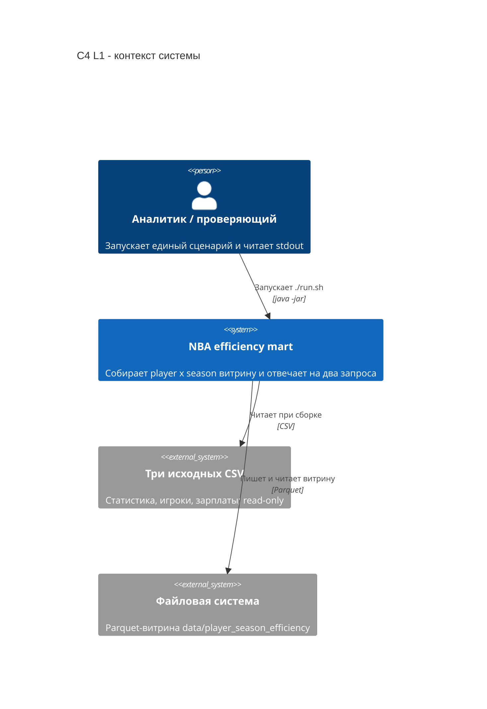
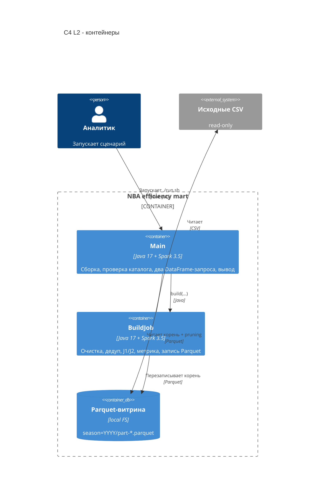
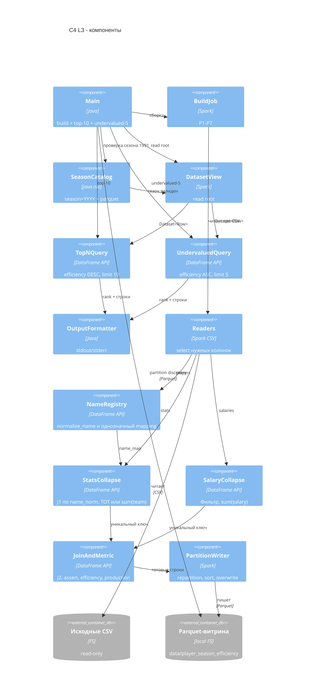
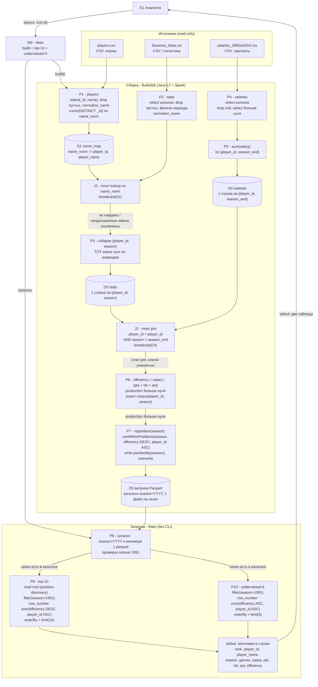

# Дизайн: витрина эффективности игроков NBA (Java 17 + Spark 3.5)

Источник требований — `tz.md`, профили данных — `passports/*.md`.
Реализация — **Java**, один Maven-проект, один сценарий `Main` (сборка + два явных запроса), Spark в локальном режиме.
Документ фиксирует архитектуру (C4), потоки данных (DFD), контракты схем и места, где
обеспечиваются дедупликация, уникальность ключей и partition pruning. Цифры объёмов
посчитаны по текущим исходным файлам.

## 1. Границы и инварианты

В объёме: очистка трёх CSV, реестр имён с исключением однофамильцев, два соединения, метрика, запись
Parquet с партиционированием по сезону, явные запросы top/undervalued из `Main` с проверкой
каталога сезонов и pruning. Вне объёма — инфляционная корректировка, ручное разрешение однофамильцев,
инкрементальные обновления, Hive/метастор, UI (см. `tz.md` §11).

Инварианты, которые проверяются в коде, а не предполагаются:

| # | Инвариант | Где обеспечивается |
|---|---|---|
| I1 | На вход J2 обе стороны имеют ровно одну строку на ключ | P3/P5 (DFD), assert в P6 |
| I2 | После J2 нет преобразующей дедупликации/агрегации — только метрика, фильтр и контрольный assert уникальности | P6 |
| I3 | `(player_id, season)` уникален в результате | assert в P6 до записи |
| I4 | В выходе ровно 9 колонок §6.1, без временных полей | финальный `select` + assert схемы |
| I5 | `efficiency` хранится как `double` без округления | P6, округление только в выводе запроса |
| I6 | Чтение — только с корня, `season` из каталогов | `Main`: `spark.read().parquet(root)` |
| I7 | Каталог сезонов строится по ФС, не по диапазону 1985–2017 | SeasonCatalog |
| I8 | Перезапись корня полная и идемпотентная | PartitionWriter (static overwrite) |

## 2. Ключевые решения

| # | Решение | Почему | Следствие |
|---|---|---|---|
| A1 | Связь stats → players только через `name_norm`; имена с `count(distinct _id) > 1` исключаются целиком | в stats нет ID; угадывать игрока запрещено ТЗ | 43 имени / 89 `_id` исключены; 326 строк stats в периоде потеряны |
| A2 | Агрегация каждой стороны **до** J2; после J2 — только метрика, фильтр и контрольный assert | иначе TOT/командные строки и трейды размножат join | 16 606 → 13 617 и 13 612 → 13 237 до join |
| A3 | Оба соединения — broadcast малой стороны | стороны 4.6k / 13k строк; shuffle не нужен | `BroadcastHashJoin`, без sort-merge |
| A4 | `repartition(col("season"))` → `sortWithinPartitions(season ASC, efficiency DESC, player_id ASC)` → `partitionBy("season")` | хеш-партиционирование не разрывает сезон между задачами; Spark при `partitionBy` требует порядок по partition-колонке и иначе добавляет свой `Sort`, теряя порядок файла | ровно один файл на сезон, внутри файла `efficiency DESC, player_id ASC` |
| A5 | Полная статическая перезапись корня (`mode=overwrite`) | удаляет устаревшие партиции, повторный запуск идемпотентен | каталог сезонов всегда соответствует последней сборке |
| A6 | Каталог сезонов — обход ФС; запрос читает корень и фильтрует литералом сезона | pruning без хардкода диапазона и без полного сканирования | читается один файл партиции |
| A7 | Один shaded jar (Spark-зависимости включены), запуск через `run.sh` | `spark-submit` в окружении не установлен; запуск самодостаточен | jar ~300 МБ; `run.sh` добавляет Java 17 `--add-opens`; для `spark-submit` — Maven-профиль `spark-provided` |
| A8 | `Main` без CLI: сезон и лимиты заданы константами | по требованию нужны явные запросы, а не парсинг аргументов | `./run.sh` без аргументов; смена параметров — правка констант `Main` |
| A9 | CSV читается с `header=true` без `inferSchema`; нужные колонки — `select` по имени + `cast` | Spark CSV с навязанной `StructType` маппит поля по позиции, а не по имени: частичная схема прочитала бы первые N колонок файла | все поля приходят строками; типы задаются явными cast, лишние колонки не участвуют |

## 3. C4

### 3.1. Уровень 1 — контекст



### 3.2. Уровень 2 — контейнеры



### 3.3. Уровень 3 — компоненты



Контракт компонентов: `Main` — единственный сценарий: `BuildJob.build(...)`, проверка
каталога через `SeasonCatalog`, чтение корня и два явных DataFrame-запроса. `Readers` отдаёт три
`Dataset<Row>` с уже спроецированными колонками; `NameRegistry` — один малый датасет
`name_map` (неоднозначные имена отфильтрованы); `StatsCollapse` и `SalaryCollapse` —
по одной строке на ключ;
`JoinAndMetric` — финальные 9 колонок; `PartitionWriter` не знает ничего о происхождении
данных.

## 4. DFD

### 4.1. Элементы DFD

**Внешние сущности**

| ID | Элемент | Роль |
|---|---|---|
| E1 | Аналитик | запускает `./run.sh`, читает stdout |
| F1 | `Seasons_Stats.xls` | read-only источник сезонной статистики |
| F2 | `players.csv` | read-only справочник игроков |
| F3 | `salaries_1985to2018.csv` | read-only источник зарплат |

**Процессы**

| ID | Процесс | Вход → выход |
|---|---|---|
| M0 | Main scenario | E1 → `BuildJob` → P8–P10 → stdout |
| P1 | players registry | `players.csv` → `D1` |
| P2 | stats clean | `Seasons_Stats.xls` → очищенные строки периода 1985–2017 |
| J1 | name lookup | stats + `D1` → stats с `player_id` |
| P3 | stats collapse | J1 → `D3` (TOT или сумма команд) |
| P4 | salaries clean | `salaries.csv` → строки периода, `salary > 0` |
| P5 | salary sum | P4 → `D4` (сумма по трейдам) |
| J2 | salary join | `D3` + `D4` → строки `(player_id, season)` |
| P6 | metric | J2 → `production`, `efficiency`, assert уникальности |
| P7 | partition write | P6 → `D5` |
| P8 | season catalog | `D5` → проверенный сезон 1991 |
| P9 | top-10 query | `D5` → stdout, `efficiency DESC` |
| P10 | undervalued-5 query | `D5` → stdout, `efficiency ASC` |

**Хранилища данных**

| ID | Хранилище | Содержимое |
|---|---|---|
| D1 | `name_map` | `name_norm → player_id, player_name` без однофамильцев |
| D3 | `stats` | одна строка на `(player_id, season)` |
| D4 | `salaries` | одна строка на `(player_id, season_end)` |
| D5 | Parquet-витрина | `season=YYYY/part-*.parquet`, 1 файл на сезон |

### 4.2. Уровень 1 — потоки данных, оба join и потери строк



Сплошные стрелки — потоки данных. E1 запускает M0; M0 вызывает `BuildJob` (P1–P7),
затем P8–P10 и получает stdout. Значения `1991`, `5` и `10` — константы `Main`. На рёбрах
показаны только правила отсечения, без фактических объёмов (они — в таблице 4.4). Порядок
строго по ТЗ §4: сначала независимая очистка и агрегация каждой стороны, затем J2; J1 —
это не join из §4.4, а lookup внутри подготовки stats (по §4.2).

### 4.3. Где именно учтён дедуп

| # | Датасет | Ключ | Правило | Почему так | Эффект на текущих данных |
|---|---|---|---|---|---|
| D-1 | players | `name_norm` | `count(DISTINCT _id)`; ровно 1 → mapping, больше 1 → имя исключается целиком | в stats нет ID; выбор «наиболее вероятного» запрещён | 4 596 имён в mapping; 43 имени / 89 игроков исключены |
| D-2 | stats | `(player_id, season)` | если у пары есть `Tm = "TOT"` — берётся только TOT; иначе сумма строк команд | TOT уже является суммой команд, сложение = двойной учёт | 2 989 командных строк отброшено anti-join по TOT-ключам; 16 606 → 13 617 |
| D-3 | salaries | `(player_id, season_end)` | `sum(salary)` | трейд разбивает выплату на несколько строк | 13 612 → 13 237; 375 строк свёрнуто |
| D-4 | после J2 | `(player_id, season)` | assert `count = 1`, иначе сборка падает | join не должен размножать строки; `distinct` после join запрещён | 12 124 пары, дублей 0 |
| D-5 | после J2 | `production > 0` | отсечение строк | защита от деления на ноль | −21 строка |

Повторяющиеся строки одного и того же `_id` в players не создают неоднозначности: D-1
считает именно `DISTINCT _id`. Blacklist применяется ко всем сезонам игрока, даже если
статистика есть только за часть сезонов.

### 4.4. Объёмы по этапам (текущие файлы)

| Этап | players | stats | salaries |
|---|---:|---:|---:|
| строк в файле | 4 685 | 24 691 | 14 163 |
| после удаления пустых строк | 4 685 | 24 624 (−67) | 14 163 |
| после фильтра периода 1985–2017 | 4 685 | 17 100 | 13 612 (−551 за 2018) |
| после имени / очистки | 4 596 имён в mapping; 43 имени исключены (89 `_id`) | 16 606 (−494: 326 неоднозначных + 168 не найдено) | 13 612 |
| после дедупа/агрегации (вход J2) | — | 13 617 (1 строка на ключ) | 13 237 (1 строка на ключ) |
| J2 (inner) | — | 12 124 (−1 493 без зарплаты) | 12 124 (−1 113 без статистики) |
| `production <= 0` | — | −21 | — |
| **результат** | | **12 103 строки, 33 сезона** | |

Строка `players` в таблице: 4 685 строк и 4 685 уникальных `_id` (дублей нет), но после
фильтра неоднозначных имён остаётся 4 596 разрешённых имён. Значения совпадают с ориентиром
ТЗ §10 (12 124 пары, 21 отсечённая строка, 12 103 строки).

Почему после дедупа отбрасывается мало — баланс строк stats:

```text
24 691 (файл) − 67 (пустые) − 7 524 (вне периода 1985–2017) = 17 100
17 100 − 494 (имя не найдено / неоднозначное)                  = 16 606
16 606 − 2 989 (командные строки, уже покрытые TOT)           = 13 617 пар
13 617 − 1 493 (нет зарплаты за сезон)                        = 12 124
12 124 − 21 (production <= 0)                                 = 12 103
```

Дедуп снимает только реальные дубли гранулярности, а не большую часть файла: 2 989
TOT-covered строк в stats (−18%) и 375 trade-строк в salaries (−2.8%). Остальные потери —
фильтр периода (−7 524), join по имени (−494) и inner join с зарплатами (−1 493, −11% пар).
Большая часть пар stats имеет зарплату (12 124 из 13 617, 89%), поэтому после свёртки объём
сокращается на проценты, а не в разы. В players дедуп почти ничего не снимает: файл — одна
строка на игрока, отсекаются только 89 `_id`, попавших в 43 неоднозначных имени.

## 5. Контракты данных

### 5.1. Входные проекции (читаются только эти колонки)

| Файл | Колонки | Тип после select/cast |
|---|---|---|
| `players.csv` | `_id`, `name` | string, string |
| `Seasons_Stats.xls` | `Player`, `Year`, `Tm`, `G`, `PTS`, `TRB`, `AST` | string, int, string, long, long, long, long |
| `salaries_1985to2018.csv` | `player_id`, `season_end`, `salary` | string, int, long |

CSV читается как `header=true` без `inferSchema`: все поля приходят строками, нужные колонки
выбираются по именам из header и кастуются. Навязывать частичную `StructType` нельзя:
Spark CSV сопоставляет схему с файлом **по позиции**, поэтому 7-колоночная схема
прочитала бы первые 7 колонок файла вместо `Player/Year/Tm/...`. Полная схема на 53
колонки не нужна: header даёт имена, cast — типы. `Year`/`season_end` кастуются в int;
меры и `salary` — в long через `double`, чтобы одинаково принимать `82`, `82.0` и большие
зарплаты (double точно представляет целые до 2^53); пустые значения остаются `null`.

### 5.2. Промежуточные датасеты

| Датасет | Колонки | Уникальность |
|---|---|---|
| `name_map` | `name_norm string`, `player_id string`, `player_name string` | 1 строка на `name_norm` |
| `stats` | `player_id string`, `player_name string` (константа на игрока), `season int`, `games long`, `pts long`, `trb long`, `ast long` | 1 строка на `(player_id, season)` |
| `salaries` | `player_id string`, `season_end int`, `salary long` | 1 строка на `(player_id, season_end)` |
| `joined` | те же ключи + `player_name`, `salary`, меры | 1 строка на `(player_id, season)` |

`Tm`, `name_norm`, `Year`, `Player` живут только до свёртки stats. `player_name` — не
временное поле: это каноническое имя из `players`, оно переносится в результат.
`production` — временное выражение внутри P6, в выход не попадает.

### 5.3. Выходная схема (порядок select при записи)

| # | Колонка | Тип Spark | Источник |
|---|---|---|---|
| 1 | `season` | int | `Year`, партиционирующая колонка |
| 2 | `player_id` | string | `players._id` |
| 3 | `player_name` | string | `players.name` (переносится через stats) |
| 4 | `games` | int | `sum(G)` |
| 5 | `salary` | long | `sum(salary)` |
| 6 | `pts` | int | `sum(PTS)` |
| 7 | `trb` | int | `sum(TRB)` |
| 8 | `ast` | int | `sum(AST)` |
| 9 | `efficiency` | double | `salary / (pts + trb + ast)` |

При записи `partitionBy("season")` колонка `season` физически не дублируется в файле.
Важное следствие для проверок: после `spark.read.parquet(root)` Spark добавляет
восстановленную партиционирующую колонку **в конец** схемы, то есть логический порядок
будет `player_id … efficiency, season`. Это не нарушает §6.1 (набор колонок), но
нельзя проверять порядок колонок после чтения; запрос перечисляет колонки явно.

Суммы считаются в `long` и приводятся к `int` в финальном select: исходные значения
(максимум 4 029 очков) заведомо ниже границы `int`. Схема проверяется assert-ом перед записью.

### 5.4. Отбрасывание колонок до join

Порядок §4 ТЗ соблюдается буквально: проекция — первое действие с каждым файлом, **до**
очистки строк, агрегации и J2. Отбрасываются не только исходные колонки, но и временные
поля: к моменту J2 в stats не остаётся `Player`, `Year`, `Tm`, `name_norm`, в salaries —
`team`, `season`, `season_start`.

| Датасет | Отбрасывается при чтении | Временные поля (живут до своего этапа) | Что остаётся для следующих этапов |
|---|---|---|---|
| `players.csv` | 23 из 25: `index`, `career_*`, биография, драфт, `college`, `height`, `weight`, `highSchool`, `shoots`, `position` | `name_norm` — ключ J1 | `name_map` для J1: `name_norm`, `player_id`, `player_name` |
| `Seasons_Stats.xls` | 46 из 53: `Unnamed: 0`, `Pos`, `Age`, `GS`, `MP`, все проценты, `PER`, `WS`, `BPM`, `VORP`, `FG/FT/...` | `Player`, `Year`, `Tm`, `name_norm` | `player_id`, `player_name`, `season`, `games`, `pts`, `trb`, `ast` |
| `salaries_1985to2018.csv` | 5 из 8: `index`, `league`, `season`, `season_start`, `team` | — | `player_id`, `season_end`, `salary` |
| после J2 | — | `season_end`, `production` | 9 выходных колонок §5.3 |

`name_norm` после подготовки остаётся только в `name_map` — это ключ J1, а не поле результата.
J2 соединяет уже сокращённые стороны: ключи `(player_id, season)` и меры; никакие исходные
или технические колонки в него не попадают.

Сразу после проекции отбрасываются строки, у которых пусты ключевые поля: players —
`_id`/`name`, stats — `Player`/`Year`, salaries — `player_id`/`season_end`/`salary`
(и `salary <= 0`). Такие строки не доходят ни до J1, ни до J2. Исключение — `G`/`PTS`:
по §4.2.4 их проверка стоит после свёртки, потому что
строка с пустым `PTS` может нести валидные `TRB`/`AST`; раннее удаление исказило бы суммы.
На текущих данных строк без `G`/`PTS` в периоде нет.

## 6. Алгоритмы сборки

### 6.1. `normalize_name` — одна реализация на обе стороны

```java
static Column normalizeName(Column c) {
    return trim(regexp_replace(
        regexp_replace(
            regexp_replace(lower(trim(c)), "\\*", " "),
            "[^a-z0-9 ]+", " "),
        " +", " "));
}
```

Порядок ровно по §4.1: trim → lower → метка `*` и все не-`[a-z0-9 ]` в пробел → схлопывание
пробелов → trim. Функция применяется к `players.name` и `Seasons_Stats.Player`; это
`Column`-выражение, без Python UDF и без сериализации. Акцентированные/нелатинские символы
по правилу ТЗ заменяются пробелом — это осознанное ограничение, а не баг (риск Р-1).

### 6.2. Реестр имён

```java
Dataset<Row> registry = players
    .filter(col("_id").isNotNull().and(length(trim(col("_id"))).gt(0))
        .and(col("name").isNotNull()).and(length(trim(col("name"))).gt(0)))
    .select(col("_id").as("player_id"), col("name").as("player_name"),
            normalizeName(col("name")).as("name_norm"))
    .groupBy("name_norm")
    .agg(countDistinct("player_id").as("id_count"),
         first("player_id").as("player_id"),
         first("player_name").as("player_name"));

Dataset<Row> nameMap = registry.filter(col("id_count").equalTo(1))
                               .select("name_norm", "player_id", "player_name");
```

`first(...)` безопасен: в текущих данных один `_id` = одна строка; повторяющиеся строки
одного `_id` не влияют на `countDistinct`. Имена с `id_count > 1` не попадают в
`name_map` и исключаются на J1; отдельный датасет исключённых имён не строится.

### 6.3. Stats: проекция, фильтры, J1, свёртка

1. Чтение с `header=true` без `inferSchema`; `select` 7 колонок по именам; `Year` → int,
   меры → long через `double`.
2. Удаление строк без `Player`/`Year`; полностью пустые строки (67 шт.) имеют пустой
   `Year`, поэтому отдельный проход по всем колонкам не нужен.
3. Фильтр `Year BETWEEN 1985 AND 2017`; `season = Year.cast(int)`.
4. `name_norm = normalize_name(Player)`; `inner` join с `broadcast(name_map)` по `name_norm`.
   Строки без совпадения и с неоднозначным именем отсекаются здесь.
5. Меры приводятся к `long` (nullable): `G`/`PTS` не фильтруются до свёртки — правило
   «удалить строки без `G`/`PTS`» применяется после неё, как в §4.2.4.
6. Свёртка до `(player_id, season)`:

```java
// Java API принимает список колонок как scala Seq — конверсия инкапсулирована в хелпере
static Dataset<Row> joinUsing(Dataset<Row> l, Dataset<Row> r, String how, String... using) {
    return l.join(r, JavaConverters.asScalaBuffer(Arrays.asList(using)).toSeq(), how);
}

Dataset<Row> tot    = named.filter(col("Tm").equalTo("TOT"));
Dataset<Row> totKey = tot.select("player_id", "season").distinct();      // ключи, не данные
Dataset<Row> team   = joinUsing(named.filter(not(col("Tm").equalTo("TOT"))),
                                broadcast(totKey), "left_anti", "player_id", "season");
Dataset<Row> collapsed = tot.unionByName(team)
    .groupBy("player_id", "season")
    .agg(first("player_name").as("player_name"),
         sum("G").as("games"), sum("PTS").as("pts"),
         sum("TRB").as("trb"), sum("AST").as("ast"));

// строки без G/PTS удаляются; null TRB/AST не заполняются
Dataset<Row> stats = collapsed
    .filter(col("games").isNotNull().and(col("pts").isNotNull()));
```

7. Строки без `games`/`pts` удаляются; `TRB`/`AST` остаются nullable. Если `TRB` или `AST`
   равны `null`, `production` тоже `null`, и строка отсекается фильтром `production > 0`
   на этапе метрики.

`distinct()` здесь — только построение множества TOT-ключей до свёртки; данные не
дедуплицируются повторно. Anti-join гарантирует, что TOT-строка и строки команд не
складываются. `player_name` — каноническое имя из `name_map`, константа на `player_id`;
оно нужно выходной схеме, поэтому переносится через свёртку (исходный `Player` при этом
отбрасывается, как требует §4.2.4). После свёртки остаются ключи, имя и меры.

### 6.4. Salaries

1. Чтение с `header=true` без `inferSchema`; `select` трёх колонок по именам;
   `season_end` → int, `salary` → long через `double`.
2. Непустые ключи (null и пустая строка), `salary > 0`. Сезон не фильтруется здесь:
   `inner join` со stats (1985–2017) сам отсекает лишние `season_end`.
3. `groupBy(player_id, season_end).agg(sum(salary))` — ровно одна строка на ключ.
4. `salary` остаётся `long`, пропуски не заполняются и не оцениваются.

### 6.5. J2 и проверки до метрики

```java
Dataset<Row> joined = stats.as("s")
    .join(broadcast(salaries.as("l")),
          col("s.player_id").equalTo(col("l.player_id"))
              .and(col("s.season").equalTo(col("l.season_end"))),
          "inner")
    .select(col("s.player_id"), col("s.season"), col("s.player_name"),
            col("s.games"), col("l.salary"), col("s.pts"), col("s.trb"), col("s.ast"));
```

Отдельного фильтра «без зарплаты» после J1 нет: J2 — `inner join`, и именно он отсекает
такие пары. Фильтровать игрока целиком после J1 нельзя: зарплата
задана на `(player_id, season)`, и игрок может иметь контракт в других сезонах. Ранний
semi-join по зарплатным ключам дал бы тот же результат, но это второй проход по тем же
данным и нарушение порядка «сначала агрегация stats, затем join с salaries».

Стоимостная проверка: J2 — broadcast hash join. Чтобы отсеять пару semi-join-ом, её ключ
всё равно проверяется по тем же salaries, после чего J2 проверяет выжившие повторно — два
lookup вместо одного. Фильтр на уровне игрока тем более не помогает: из 1 493 пар без
зарплаты только 308 (239 игроков) относятся к игрокам без зарплаты в периоде; остальные
1 185 — сезонные пропуски у игроков с контрактами в других сезонах. Early semi-join/Bloom
имел бы смысл при shuffle/sort-merge join и больших объёмах, но не при 13k строк и
broadcast.

Перед метрикой — assert уникальности одним действием (`joined` кэшируется, чтобы assert
и метрика не пересчитывали план):

```java
long dup = joined.groupBy("player_id", "season").count()
                 .agg(max("count").as("m")).head().getLong(0);
if (dup > 1) throw new IllegalStateException("duplicate (player_id, season) after join");
```

Нарушение — ошибка сборки, а не повод для `distinct`. Это единственный `groupBy` после J2:
контрольный запрос, который не участвует в формировании данных и не меняет их. Null-ключи
после join невозможны: обе стороны уже отфильтрованы; дополнительный фильтр не нужен
(но `player_id`/`season` входят в assert через `count`).

### 6.6. Метрика, фильтр, схема

```java
Dataset<Row> result = joined
    .withColumn("production", col("pts").plus(col("trb")).plus(col("ast")))
    .filter(col("production").gt(0))
    .withColumn("efficiency",
        col("salary").cast("double").divide(col("production").cast("double")))
    .select(col("season"), col("player_id"), col("player_name"), col("games"),
            col("salary"), col("pts"), col("trb"), col("ast"), col("efficiency"));
```

`production` не попадает в результат. Перед записью проверяется набор и типы 9 колонок
(assert по `result.schema()`); при расхождении — исключение с фактической схемой.

### 6.7. Запись и физический порядок

```java
result.repartition(col("season"))
      .sortWithinPartitions(
              col("season").asc(),
              col("efficiency").desc(),
              col("player_id").asc())
      .write().mode(SaveMode.Overwrite).partitionBy("season")
      .parquet(output);
```

- `repartition(col("season"))` — хеш по сезону: строки одного сезона не разрываются между
  задачами. Каждый сезон пишется из одной задачи, поэтому в `season=YYYY/` появляется ровно
  один Parquet-файл (служебные `_SUCCESS`, `_committed_*`, `_started_*` — не данные).
- `season` идёт первым в `sortWithinPartitions`: Spark при `partitionBy` сам требует порядок
  по partition-колонке и иначе добавляет свой `Sort`, который теряет порядок
  `efficiency DESC, player_id ASC`. Внутри файла сезон константен, поэтому остаётся
  требуемый порядок.
- `mode(overwrite)` в статическом режиме (по умолчанию `partitionOverwriteMode=static`)
  удаляет содержимое корня до записи: устаревшие партиции не остаются, повторная сборка
  идемпотентна. Корень `data/player_season_efficiency` считается принадлежащим джобе;
  посторонние файлы в нём будут удалены.
- AQE может укрупнить партиции, но не разрывает одинаковые ключи между задачами; на
  «один файл на сезон» это не влияет.

## 7. Запросы в Main

### 7.1. Сценарий и фиксированные параметры

CLI отсутствует: `Main` вызывает сборку и затем оба запроса с константами.

| Параметр | Значение | Где задан |
|---|---:|---|
| `season` | 1991 | `Main.SEASON` |
| top limit | 10 | `Main.TOP_LIMIT` |
| undervalued limit | 5 | `Main.UNDERVALUED_LIMIT` |
| корень витрины | `<project>/data/player_season_efficiency` | `ProjectPaths.projectRoot()` |

`run.sh` запускает jar без аргументов. `Main` всегда пересобирает витрину, проверяет каталог
сезонов, читает корень и печатает два результата. Ошибка (датасет не найден/пуст, сезон
отсутствует, сбой Spark) — исключение: `Main` печатает сообщение и завершает процесс с кодом 1.

### 7.2. Каталог сезонов

`SeasonCatalog.scan(root)` через `java.nio.file`:

1. Корень не существует → `датасет не найден: <path>`.
2. Для каждого элемента корня: каталог, имя строго `season=(\d{4})` (ровно 4 цифры),
   внутри есть хотя бы один файл `*.parquet` (без учёта `_SUCCESS`/`_committed_*`).
   Прочие каталоги и файлы игнорируются. Это и есть «каталог сезонов»; диапазон
   1985–2017 не участвует.
3. Список пуст → `датасет пуст: <path>`.
4. Сезона 1991 нет → `сезон 1991 отсутствует в каталоге; доступные сезоны: ...`
   (по возрастанию).
5. Найден → читаем корень и выводим оба результата.

Проверка каталога не запускает Spark-job: это ~33 операции обхода ФС, что дешевле
валидации через чтение датасета. Гонка «каталог удалён между проверкой и чтением» —
ошибка Spark, обрабатывается общим исключением `Main`.

### 7.3. Чтение и pruning

```java
Dataset<Row> dataset = spark.read().parquet(root);   // только корень, без basePath
```

`season` восстанавливается из имён каталогов (тип int). Ручное перечисление сезонов,
чтение `season=YYYY` напрямую и схема с объявленным `season` запрещены. Фильтр сезона —
`filter(col("season").equalTo(1991))` с константой, поэтому Catalyst формирует
`PartitionFilters: ... (season = 1991)`. План можно вывести через
`queryExecution().executedPlan()` при проверке; в обычном выводе он не печатается, stdout
остаётся данными. Проверка: в плане `FileScan parquet` один файл партиции.

### 7.4. DataFrame API top-N

```java
WindowSpec window = Window.partitionBy(col("season"))
        .orderBy(col("efficiency").desc(), col("player_id").asc());

Dataset<Row> result = dataset
        .filter(col("season").equalTo(SEASON))
        .withColumn("rank", row_number().over(window))
        .select(col("rank"), col("player_id"), col("player_name"), col("season"),
                col("games"), col("salary"), col("pts"), col("trb"), col("ast"),
                col("efficiency"))
        .orderBy(col("efficiency").desc(), col("player_id").asc())
        .limit(TOP_LIMIT);
```

Для undervalued те же шаги с `orderBy(efficiency.asc(), player_id.asc())` и
`UNDERVALUED_LIMIT`. Тай-брейк `player_id` делает порядок детерминированным. Окно
партиционировано по `season` (после фильтра он константен) и считается по уже
отфильтрованному набору; `limit` ограничивает вывод. SQL и temp view не используются.
Никакой запрос не полагается на физический порядок файла: явный `orderBy` обязателен.

### 7.5. Вывод

- stdout: заголовок запроса, строка колонок и строки результата; для top-10 и
  undervalued-5 — отдельные блоки. Колонки через табуляцию:
  `rank	player_id	player_name	season	games	salary	pts	trb	ast	efficiency`.
- `salary` — целое, `efficiency` — `%.6f` (округление только на выводе; в Parquet значение
  не округляется). Форматирование — через `Locale.ROOT`, чтобы в русской локали не
  появилась десятичная запятая.
- stderr: предупреждения `найдено M < N кандидатов` или `нет кандидатов`. Ошибки
  сборки/запроса `Main` печатает в stderr и завершает процесс с кодом 1.
- Spark-логи приглушаются до WARN, чтобы stdout оставался читаемым.

## 8. Почему путь данных оптимален

1. **Проекция до очистки и join.** Из 53/25/8 колонок выбираются 7/2/3 ещё при чтении;
   остальные не участвуют в преобразованиях и cast. `Tm`/`name_norm`/`Year` уходят при
   свёртке stats, `team`/`season_start` — при очистке salaries, поэтому J2 видит только
   ключи и меры. Чтение без `inferSchema` — один проход, без отдельного прохода на
   определение типов.
2. **Ранние фильтры.** Строки без ключей (players — `_id`/`name`, stats — `Player`/`Year`,
   salaries — `player_id`/`season_end`), пустые строки stats, `Year` вне 1985–2017
   отсекаются до нормализации и join; в salaries также `null`/пустой `salary` и `salary <= 0`.
3. **Агрегация до join.** 16 606 → 13 617 и 13 612 → 13 237; join получает по одной строке
   на ключ, поэтому не размножает строки и не требует последующего `distinct`.
4. **Broadcast-соединения.** `name_map` (4 596 строк) и salaries (13 237 строк)
   транслируются в stats: `BroadcastHashJoin` без shuffle и sort-merge. Оба датасета
   заведомо малы; hint `broadcast()` фиксирует выбор независимо от порога.
5. **Один узкий этап после J2.** Метрика и фильтр — map-операции без обмена; единственный
   shuffle сборки — `repartition(season)` перед записью.
6. **Сортировка только внутри партиции.** `sortWithinPartitions(season, efficiency DESC,
   player_id ASC)` не требует глобального sort-shuffle; `season` идёт первым, потому что
   Spark при `partitionBy` иначе добавляет собственный `Sort` по partition-колонке и
   теряет порядок файла. Внутри файла остаётся `efficiency DESC, player_id ASC`.
7. **Запись без лишних файлов.** Хеш-партиционирование по сезону + `partitionBy` даёт ровно
   33 файла (по одному на сезон) и полную перезапись корня.
8. **Запрос без полного сканирования.** Каталог — обход ФС, затем pruning по `season`:
   читается один файл (~370 строк на сезон); `orderBy` сортирует только эту партицию,
   `limit` ограничивает вывод. Валидация сезона не требует Spark-job.
9. **Один проход по каждому источнику.** Каждый файл читается один раз; промежуточные
   датасеты переиспользуются в join, повторных чтений нет.

## 9. Риски и ограничения

| # | Риск | Митигация / следствие |
|---|---|---|
| Р-1 | Нормализация по ТЗ превращает акценты и нелатинские символы в пробелы: возможны коллизии имён и потери | на текущих данных не найдено 28 имён / 168 строк; 43 имени / 89 `_id` исключены, из них 30 имён / 326 строк со статистикой в периоде |
| Р-2 | Сезоны 1987 и 1990 неполны в зарплатах | пропуски не заполняются; отсутствие зарплаты ≠ отсутствие контракта |
| Р-3 | Зарплаты не приведены к инфляции | метрика сравнивается только внутри сезона; межсезонные сравнения запрещены |
| Р-4 | `TRB`/`AST` null не заменяются на 0 | `production` становится null, строка отсекается фильтром `production > 0` |
| Р-5 | Физическая сортировка файла не является контрактом запроса | каждый запрос содержит `orderBy`; top-10 может использовать early-stop, но не обязан |
| Р-6 | Полная перезапись корня удаляет всё в `data/player_season_efficiency` | путь считается принадлежащим сборке; это требование §6.2 |
| Р-7 | `season` после чтения оказывается последней колонкой | запросы перечисляют колонки явно; проверяется набор, а не порядок |
| Р-8 | Добавленный вручную каталог `season=YYYY` меняет каталог сезонов | это требуемое поведение §6.2.5; некорректный шаблон игнорируется |
| Р-9 | Один сезон может оказаться в задаче вместе с другими | на «1 файл на сезон» не влияет: каждая задача пишет отдельный файл в каталог каждого сезона |
| Р-10 | Spark 3.5 на Java 17 требует `--add-opens` при прямом `java -jar` | `run.sh` содержит набор опций; для `spark-submit` — профиль `spark-provided` |

## 10. Проверка после реализации

```bash
mvn -q package
./run.sh
find data/player_season_efficiency -name '*.parquet' | wc -l   # 33
```

`./run.sh` выполняет весь сценарий: сборку, top-10 и undervalued-5 для сезона 1991.
Пункты ТЗ, завязанные на CLI (`--season`, `--data`, коды выхода), заменены явным сценарием
`Main`; семантика проверки сезона, пустого результата и ошибок сохранена.

Соответствие критериям §10 ТЗ:

| # | Критерий | Чем обеспечен |
|---:|---|---|
| 1 | 33 партиции, по одному файлу | repartition(season) + partitionBy; проверка `find` |
| 2 | идемпотентность | статическая перезапись корня; повторный запуск и сравнение строк |
| 3 | `season` без схемы при чтении корня | partition discovery, `spark.read.parquet(root)` |
| 4 | ровно 9 колонок | финальный `select`, assert схемы до записи |
| 5 | дедуп до join, нет пост-join преобразований | D-2/D-3; после J2 только метрика/фильтр, плюс контрольный assert D-4 (не меняет данные) |
| 6 | `efficiency = salary / production` (±1e-9) | P6; сверка независимым запросом |
| 7 | N строк, порядок, сезон, тай-брейк | `orderBy(efficiency, player_id)`, `limit` |
| 8 | `PartitionFilters` и один файл | фиксированный литерал `1991`; `executedPlan()` при проверке |
| 9 | нет сезона ≠ нет кандидатов | `validateSeason` + разные сообщения; пустой результат — предупреждение |
| 10 | запуск не зависит от cwd | `ProjectPaths.projectRoot()` для исходников и витрины |
| 11 | физический порядок в файле | `sortWithinPartitions`; последовательное чтение одной партиции |

## 11. Структура проекта (предлагаемая)

```text
pom.xml                                  # Java 17, Spark 3.5.x, maven-shade, профиль spark-provided
run.sh                                   # java --add-opens ... -jar target/nba-efficiency.jar (без аргументов)
src/main/java/ru/ppp/lab4/
  Main.java                              # сценарий: build + top-10 + undervalued-5
  common/Names.java                      # normalizeName(Column)
  common/SeasonCatalog.java              # обход ФС, season=YYYY
  common/ProjectPaths.java               # корень проекта, пути исходников и витрины
  common/Spark.java                      # SparkSession (local[*])
  build/BuildJob.java                    # оркестрация P1-P7
  build/Readers.java                     # 3 CSV: header=true, select по имени, cast
  build/NameRegistry.java                # D1: name_norm -> player_id
  build/StatsCollapse.java               # J1, TOT/team
  build/SalaryCollapse.java              # очистка и sum
  build/JoinAndMetric.java               # J2, assert, efficiency
  build/PartitionWriter.java             # repartition/sort/overwrite
```

Компоненты C4 соответствуют пакетам/классам один-к-одному; мелкие утилиты (`Names`,
`ProjectPaths`) не выделяются в отдельные C4-компоненты. Shade-плагин обязан
подключить `ServicesResourceTransformer` и исключить подписи `META-INF/*.SF|DSA|RSA`,
иначе jar падает на старте.
